# Corne ZMK configuration

This repository contains the ZMK configuration and keymap for a Corne keyboard.

## Updating the diagram

Run `make draw` to regenerate the layout SVG and parsed keymap from `config/corne.keymap`. The default command uses `uvx`; alternatively, install `keymap-drawer` with `pipx` and run `make draw KEYMAP_DRAWER=keymap`.

## Firmware builds

The left- and right-half Corne firmware builds are configured in [build.yaml](build.yaml).
